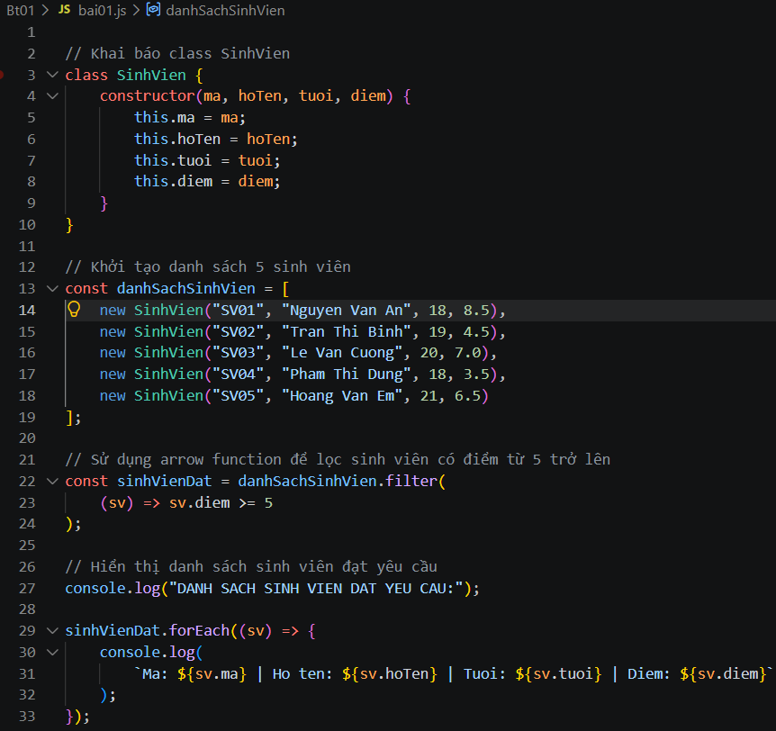
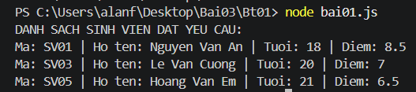

# BÀI 01 - QUẢN LÝ THÔNG TIN SINH VIÊN BẰNG JAVASCRIPT ES6

## 1. Mục tiêu
Thực hành lập trình JavaScript ES6 để quản lý thông tin sinh viên.

## 2. Kiến thức sử dụng
- Class và Constructor.
- Mảng đối tượng.
- Arrow Function.
- Filter và forEach.
- Console.log().

## 3. Các bước thực hiện

### Bước 1: Kiểm tra Node.js
Lệnh:
```bash
node -v
```

### Bước 2: Chạy chương trình
Lệnh:
```bash
node bai01.js
```

### Bước 3: Kết quả
Chương trình lọc và hiển thị các sinh viên có điểm từ 5 trở lên.

## 4. Hình ảnh minh họa

### Ảnh mã nguồn


### Ảnh kết quả chạy chương trình


## 5. Kết luận
Hoàn thành bài thực hành quản lý thông tin sinh viên bằng JavaScript ES6.
