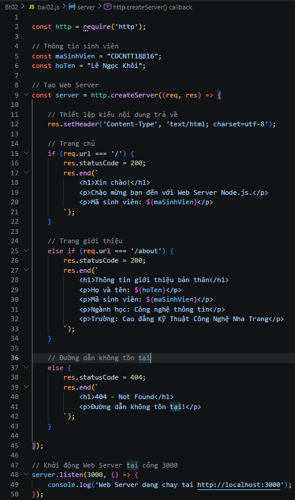
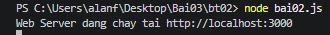
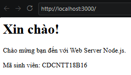
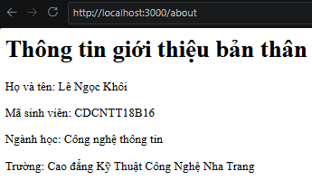
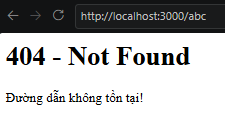

# BÀI 02 - TẠO WEB SERVER VỚI NODE.JS

## 1. Mục tiêu
Sử dụng Node.js để tạo Web Server và xử lý các đường dẫn URL.

## 2. Kiến thức sử dụng
- Module http.
- http.createServer().
- server.listen().
- Request và Response.
- Mã trạng thái HTTP 200 và 404.

## 3. Các bước thực hiện

### Bước 1: Kiểm tra Node.js
```bash
node -v
```

### Bước 2: Chạy Web Server
```bash
node bai02.js
```

### Bước 3: Truy cập trang chủ
http://localhost:3000

### Bước 4: Truy cập trang giới thiệu
http://localhost:3000/about

### Bước 5: Kiểm tra đường dẫn không tồn tại
http://localhost:3000/abc

## 4. Hình ảnh minh họa

### Ảnh mã nguồn


### Ảnh kết quả Terminal


### Ảnh trang chủ


### Ảnh trang giới thiệu


### Ảnh lỗi 404


## 5. Kết luận
Hoàn thành bài thực hành tạo Web Server bằng Node.js,
sử dụng module http để xử lý các yêu cầu HTTP
và trả về nội dung tương ứng với từng đường dẫn.
