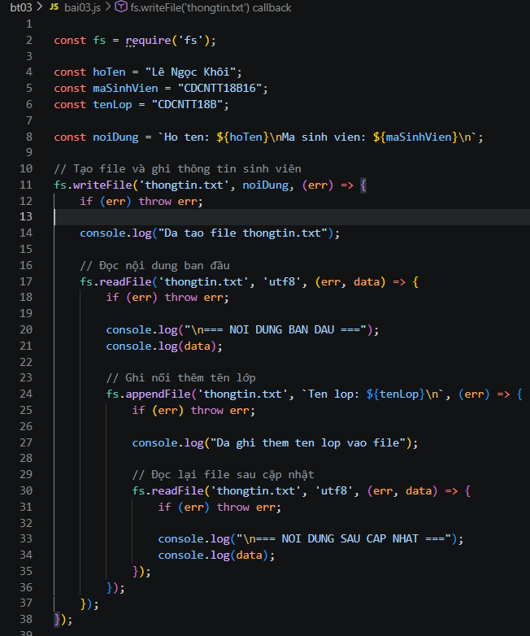
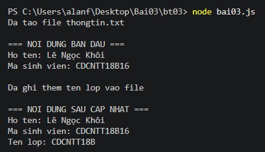
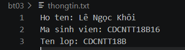

# BÀI 03 - THAO TÁC TẬP TIN BẰNG FILE SYSTEM

## 1. Mục tiêu

Sử dụng module `fs` trong Node.js để thực hiện các thao tác với tập tin.

## 2. Kiến thức sử dụng

- Module `fs`.
- `fs.writeFile()`.
- `fs.readFile()`.
- `fs.appendFile()`.
- Callback function.
- Xử lý lỗi bằng `err`.

## 3. Các bước thực hiện

### Bước 1: Kiểm tra Node.js

```bash
node -v
```

### Bước 2: Chạy chương trình

```bash
node bai03.js
```

### Bước 3: Tạo tập tin

Chương trình tạo tập tin `thongtin.txt` chứa họ tên và mã sinh viên.

### Bước 4: Đọc tập tin

Đọc và hiển thị nội dung tập tin lên Terminal.

### Bước 5: Ghi nối dữ liệu

Sử dụng `appendFile()` để ghi thêm tên lớp vào cuối tập tin.

### Bước 6: Đọc lại tập tin

Hiển thị nội dung sau khi cập nhật lên Terminal.

## 4. Hình ảnh minh họa

### Ảnh mã nguồn



### Ảnh kết quả Terminal



### Ảnh nội dung tập tin thongtin.txt



## 5. Kết luận

Hoàn thành bài thực hành thao tác tập tin bằng module File System trong Node.js: tạo file, đọc file và ghi nối thêm dữ liệu bằng `appendFile()`.