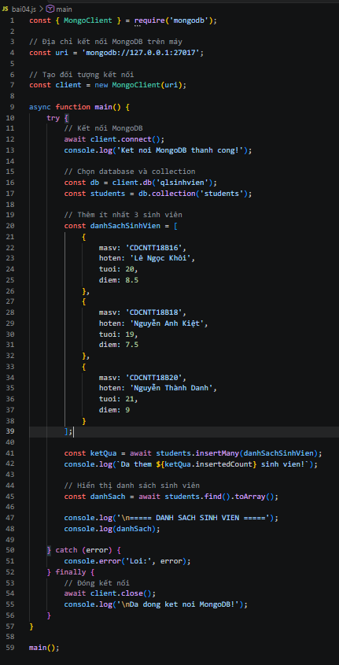
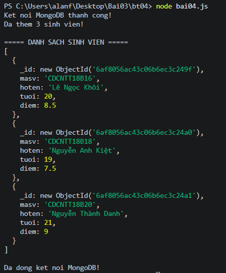
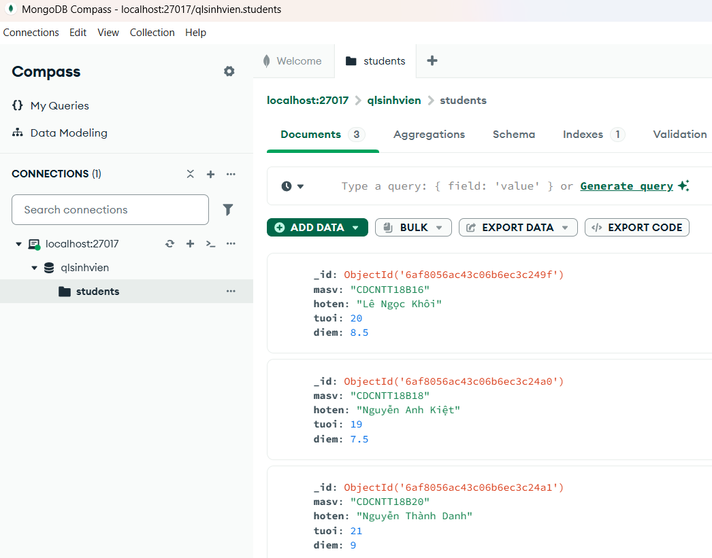

# BÀI 04 - THÊM VÀ HIỂN THỊ DỮ LIỆU MONGODB

## 1. Mục tiêu

Sử dụng Node.js kết nối MongoDB, thêm dữ liệu sinh viên và hiển thị danh sách sinh viên.

## 2. Kiến thức sử dụng

- Module `mongodb`.
- Kết nối MongoDB bằng `MongoClient`.
- Chọn database bằng `client.db()`.
- Chọn collection bằng `db.collection()`.
- Thêm dữ liệu bằng `insertMany()`.
- Hiển thị dữ liệu bằng `find()`.
- Đóng kết nối bằng `client.close()`.

## 3. Các bước thực hiện

### Bước 1: Khởi tạo dự án

```bash
npm init -y
```

### Bước 2: Cài đặt thư viện MongoDB

```bash
npm install mongodb
```

### Bước 3: Chạy chương trình

```bash
node bai04.js
```

### Bước 4: Kết nối MongoDB

Kết nối đến MongoDB đang chạy trên máy với địa chỉ `mongodb://127.0.0.1:27017`.

### Bước 5: Thêm dữ liệu sinh viên

Sử dụng `insertMany()` để thêm ít nhất 3 sinh viên vào database `qlsinhvien`, collection `students`.

Mỗi sinh viên gồm các trường: `masv`, `hoten`, `tuoi`, `diem`.

### Bước 6: Hiển thị dữ liệu

Sử dụng `find()` để lấy và hiển thị danh sách sinh viên trên Terminal.

### Bước 7: Đóng kết nối

Sử dụng `client.close()` để đóng kết nối MongoDB sau khi hoàn thành.

## 4. Hình ảnh minh họa

### Ảnh mã nguồn



### Ảnh kết quả Terminal



### Ảnh dữ liệu trong MongoDB Compass



## 5. Kết luận

Hoàn thành bài thực hành kết nối MongoDB bằng Node.js, thêm dữ liệu sinh viên bằng `insertMany()`, hiển thị dữ liệu bằng `find()` và đóng kết nối sau khi hoàn thành.