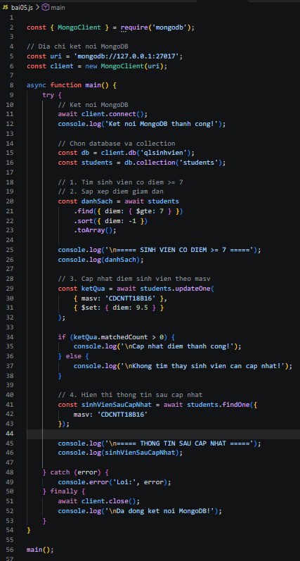
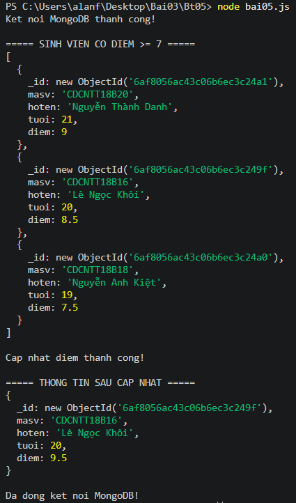
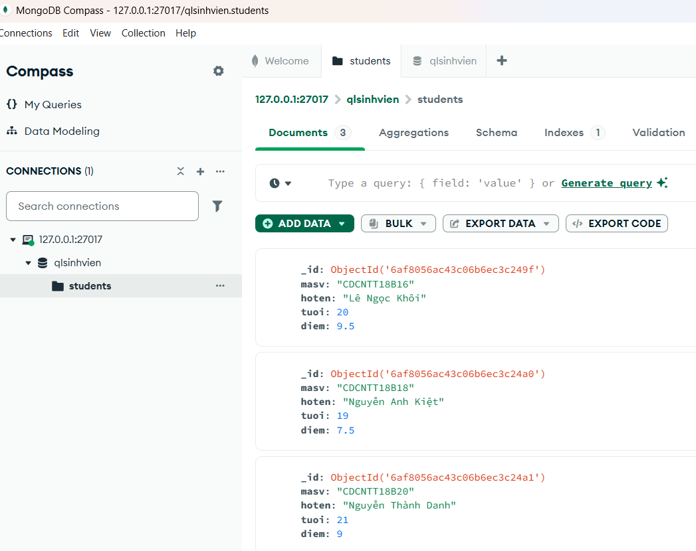

# BÀI 05 - TÌM KIẾM, CẬP NHẬT VÀ SẮP XẾP MONGODB

## 1. Mục tiêu

Sử dụng Node.js và MongoDB để tìm kiếm, sắp xếp và cập nhật dữ liệu sinh viên.

## 2. Kiến thức sử dụng

- `find()`: Tìm kiếm dữ liệu.
- `$gte`: Tìm sinh viên có điểm lớn hơn hoặc bằng 7.
- `sort()`: Sắp xếp điểm giảm dần.
- `updateOne()`: Cập nhật thông tin một sinh viên.
- `$set`: Thay đổi giá trị của trường dữ liệu.
- `findOne()`: Hiển thị thông tin sinh viên sau cập nhật.

## 3. Các bước thực hiện

### Bước 1: Khởi tạo dự án

```bash
npm init -y
```

### Bước 2: Cài đặt thư viện MongoDB

```bash
npm install mongodb
```

### Bước 3: Chạy chương trình

```bash
node bai05.js
```

### Bước 4: Tìm kiếm và sắp xếp

Sử dụng `find()` kết hợp `$gte` để tìm sinh viên có điểm lớn hơn hoặc bằng 7.

Sử dụng `sort()` để sắp xếp điểm theo thứ tự giảm dần.

### Bước 5: Cập nhật dữ liệu

Sử dụng `updateOne()` và `$set` để cập nhật điểm sinh viên theo mã sinh viên.

### Bước 6: Kiểm tra kết quả

Sử dụng `findOne()` để hiển thị thông tin sinh viên sau khi cập nhật.

## 4. Hình ảnh minh họa

### Ảnh mã nguồn



### Ảnh kết quả Terminal



### Ảnh dữ liệu MongoDB Compass



## 5. Kết luận

Hoàn thành bài thực hành tìm kiếm sinh viên theo điều kiện điểm, sắp xếp điểm giảm dần, cập nhật điểm sinh viên và kiểm tra dữ liệu sau cập nhật bằng Node.js và MongoDB.