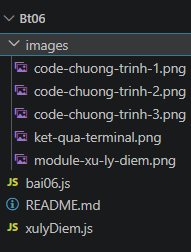
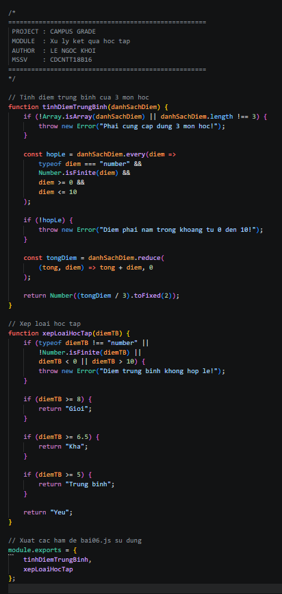
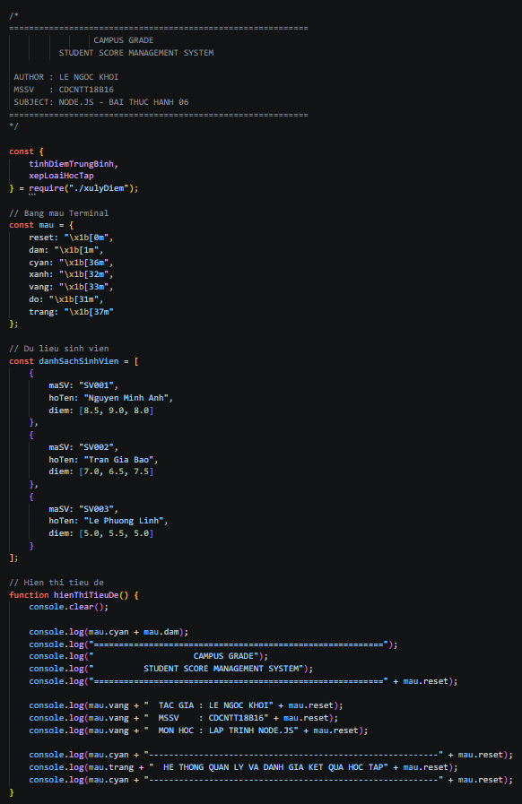
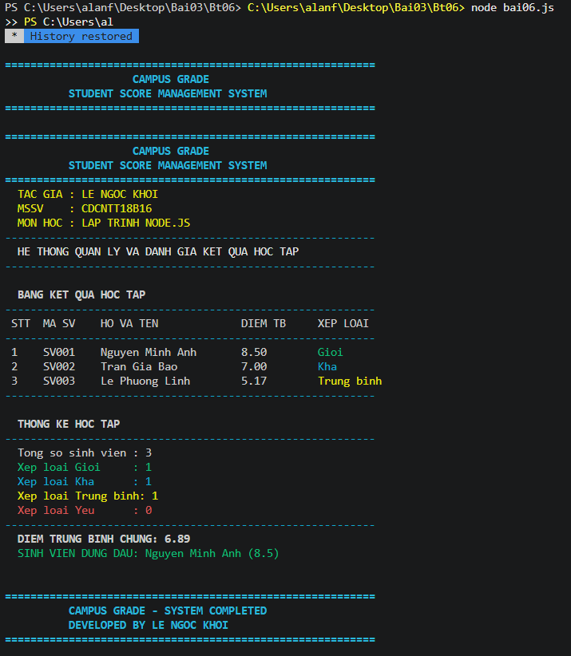

# CAMPUS GRADE
### Student Score Management System

**BÀI THỰC HÀNH 06 – XÂY DỰNG MODULE TÍNH KẾT QUẢ HỌC TẬP**

---

## 1. Thông tin sinh viên

| Thông tin | Nội dung |
|---|---|
| Họ và tên | Lê Ngọc Khôi |
| Mã sinh viên | CDCNTT18B16 |
| Ngành học | Công nghệ thông tin |
| Môn học | Lập trình Node.js |
| Bài thực hành | Bài 06 |

## 2. Giới thiệu dự án

CAMPUS GRADE là chương trình quản lý và đánh giá kết quả học tập sinh viên được xây dựng bằng JavaScript trên môi trường Node.js.

Em thực hiện dự án này nhằm tìm hiểu cách tổ chức chương trình thành nhiều module, sử dụng cơ chế xuất và gọi hàm giữa các tập tin JavaScript.

Thay vì chỉ hiển thị kết quả tính toán đơn giản, em thiết kế chương trình theo phong cách một hệ thống quản lý điểm học tập trên Terminal.

## 3. Mục tiêu thực hiện

- Tạo module xử lý điểm học tập.
- Tính điểm trung bình của 3 môn.
- Tự động xếp loại kết quả học tập.
- Sử dụng `module.exports` để xuất các hàm.
- Sử dụng `require()` để gọi module.
- Hiển thị bảng điểm và thống kê trên Terminal.

## 4. Công nghệ sử dụng

| Công nghệ | Vai trò |
|---|---|
| JavaScript | Xây dựng chương trình |
| Node.js | Chạy ứng dụng |
| CommonJS | Quản lý module |
| Visual Studio Code | Viết và chỉnh sửa mã nguồn |
| GitHub | Lưu trữ dự án |

## 5. Cấu trúc dự án

```text
Bt06/
│
├── bai06.js
├── xulyDiem.js
├── README.md
│
└── images/
    ├── cau-truc-thu-muc.png
    ├── module-xu-ly-diem.png
    ├── code-chuong-trinh.png
    └── ket-qua-terminal.png
```

### Chức năng từng tập tin

**bai06.js**

- Lưu trữ dữ liệu sinh viên.
- Gọi các hàm từ module xử lý điểm.
- Hiển thị bảng kết quả.
- Thống kê số lượng sinh viên theo xếp loại.

**xulyDiem.js**

- Kiểm tra dữ liệu điểm.
- Tính điểm trung bình 3 môn.
- Xếp loại học tập theo thang điểm quy định.
- Xuất các hàm bằng `module.exports`.

## 6. Quy tắc tính điểm và xếp loại

Điểm trung bình được tính bằng tổng điểm 3 môn chia cho 3 và làm tròn đến hai chữ số thập phân.

| Điểm trung bình | Xếp loại |
|---|---|
| Từ 8.0 trở lên | Giỏi |
| Từ 6.5 đến dưới 8.0 | Khá |
| Từ 5.0 đến dưới 6.5 | Trung bình |
| Dưới 5.0 | Yếu |

## 7. Hướng dẫn chạy chương trình

**Bước 1: Mở dự án**

Mở thư mục `Bt06` bằng Visual Studio Code.

**Bước 2: Kiểm tra Node.js**

Mở Terminal và nhập:

```bash
node -v
```

**Bước 3: Chạy chương trình**

```bash
node bai06.js
```

Chương trình không yêu cầu cài đặt thêm thư viện bên ngoài.

## 8. Hình ảnh minh chứng

### 8.1. Cấu trúc thư mục



### 8.2. Module xử lý điểm



### 8.3. Chương trình chính


(images/code-chuong-trinh-2.png)
(images/code-chuong-trinh-3.png)

### 8.4. Kết quả chạy chương trình



*Các hình ảnh trên được bổ sung sau khi thực hiện và chụp màn hình thực tế.*

## 9. Kết quả đạt được

Sau khi hoàn thành, chương trình đã thực hiện được các chức năng theo yêu cầu:

- Tạo và sử dụng module trong Node.js.
- Tính điểm trung bình của 3 môn học.
- Xếp loại học tập theo đúng điều kiện.
- Kiểm tra dữ liệu đầu vào.
- Hiển thị kết quả và thống kê trên Terminal.

## 10. Tự đánh giá và tổng kết

Qua bài thực hành này, em hiểu rõ hơn cách chia chương trình thành các module độc lập trong Node.js.

Em cũng nắm được cách sử dụng `require()` và `module.exports`, đồng thời thực hành xử lý mảng, hàm và điều kiện trong JavaScript.

Trong quá trình thực hiện, em đã chủ động thiết kế giao diện Terminal và bổ sung phần thống kê nhằm giúp kết quả dễ theo dõi hơn.

Đây là bài thực hành giúp em củng cố kiến thức nền tảng và làm quen với cách tổ chức một chương trình JavaScript có cấu trúc rõ ràng.

---

**PROJECT:** CAMPUS GRADE  
**AUTHOR:** LÊ NGỌC KHÔI  
**STUDENT ID:** CDCNTT18B16  
**SUBJECT:** NODE.JS – PRACTICE 06

*Designed and developed by Le Ngoc Khoi.*