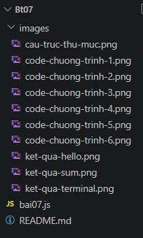
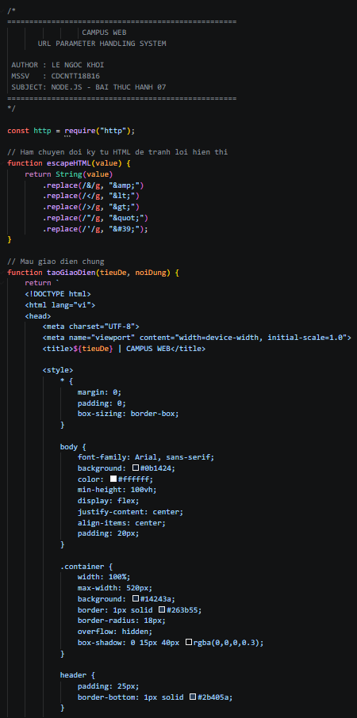
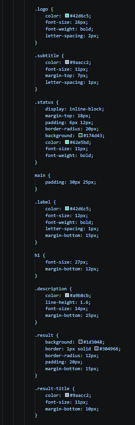
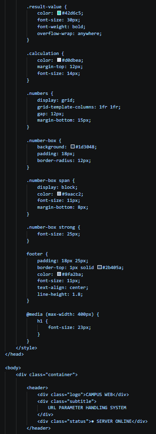
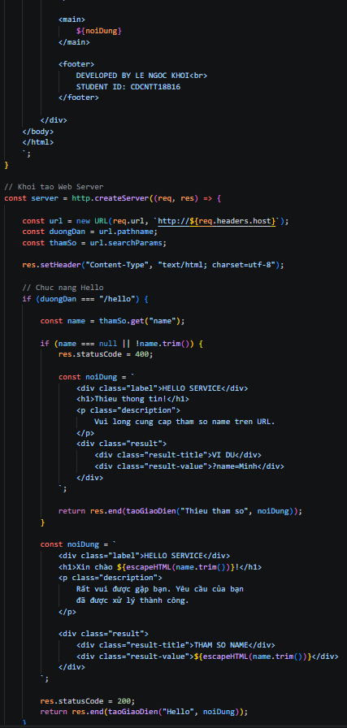
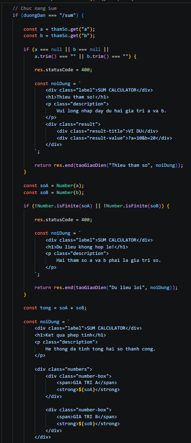
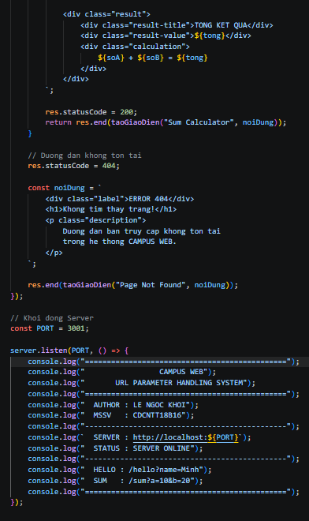
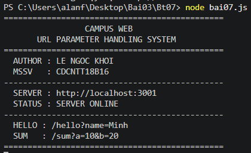
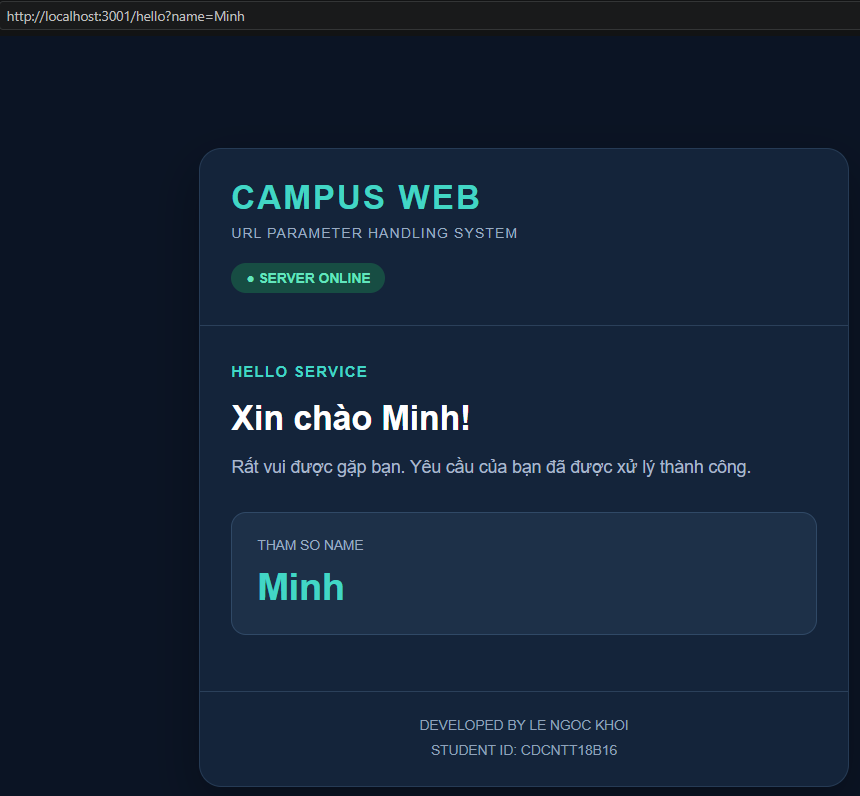
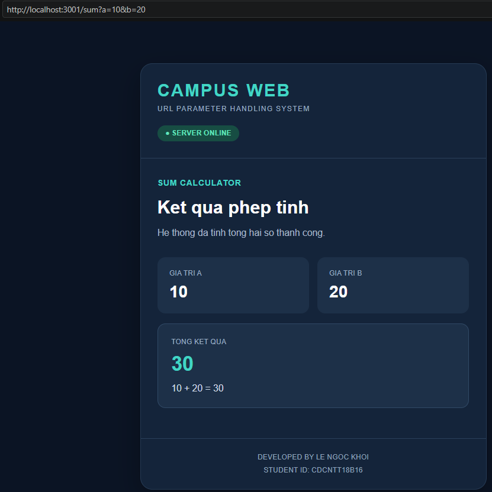

# BÀI THỰC HÀNH 07 – XỬ LÝ THAM SỐ URL TRÊN WEB SERVER

## 1. Thông tin sinh viên

- **Họ và tên:** Lê Ngọc Khôi
- **MSSV:** CDCNTT18B16
- **Ngành:** Công nghệ thông tin
- **Môn học:** Lập trình Node.js
- **Bài thực hành:** 07

## 2. Giới thiệu

Xây dựng Web Server bằng Node.js sử dụng module `http` và đối tượng `URL` để xử lý các tham số được truyền qua địa chỉ URL.

Chương trình hoạt động tại cổng 3001 và hỗ trợ chức năng chào hỏi, tính tổng hai số, đồng thời kiểm tra dữ liệu đầu vào.

## 3. Công nghệ sử dụng

- Node.js
- Module `http`
- Đối tượng `URL`
- Visual Studio Code

## 4. Các chức năng chính

- Truy cập `/hello?name=Minh` để hiển thị lời chào.
- Truy cập `/sum?a=10&b=20` để tính tổng hai số.
- Kiểm tra trường hợp thiếu tham số.
- Kiểm tra dữ liệu không hợp lệ.
- Thông báo lỗi khi truy cập đường dẫn không tồn tại.

## 5. Cấu trúc thư mục

```text
Bt07/
├── bai07.js
├── README.md
└── images/
```

## 6. Hướng dẫn thực hiện

### Bước 1: Kiểm tra phiên bản Node.js

```bash
node -v
```

### Bước 2: Khởi chạy chương trình

```bash
node bai07.js
```

### Bước 3: Truy cập Web Server

Mở trình duyệt và nhập các địa chỉ:

**Chức năng chào hỏi:**

```text
http://localhost:3001/hello?name=Minh
```

**Chức năng tính tổng:**

```text
http://localhost:3001/sum?a=10&b=20
```

## 7. Hình ảnh minh chứng

### 7.1. Cấu trúc thư mục



### 7.2. Mã nguồn chương trình













### 7.3. Kết quả chạy chương trình

**Kết quả trên Terminal:**



**Kết quả chức năng chào hỏi:**



**Kết quả chức năng tính tổng:**



## 8. Tổng kết

Qua bài thực hành, em đã tìm hiểu cách xây dựng Web Server bằng Node.js, sử dụng module `http` và đối tượng `URL` để đọc, xử lý tham số truy vấn.

Chương trình thực hiện được chức năng chào hỏi, tính tổng hai số và kiểm tra các trường hợp dữ liệu không hợp lệ.

**Người thực hiện: Lê Ngọc Khôi**  
**MSSV: CDCNTT18B16**