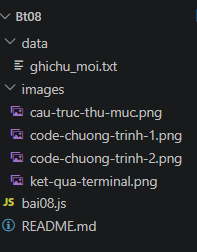
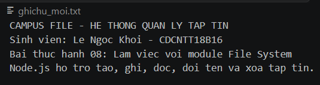
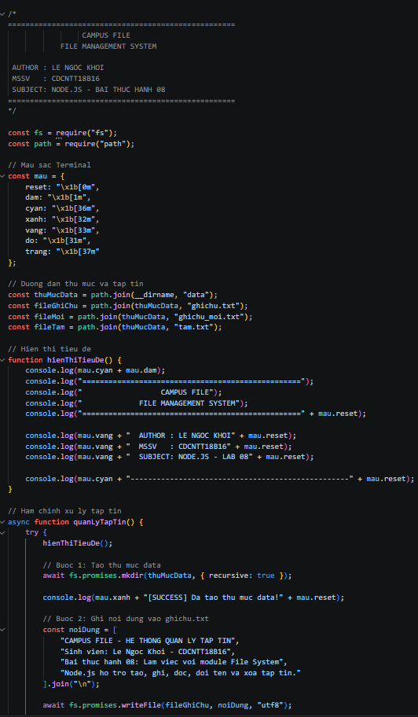
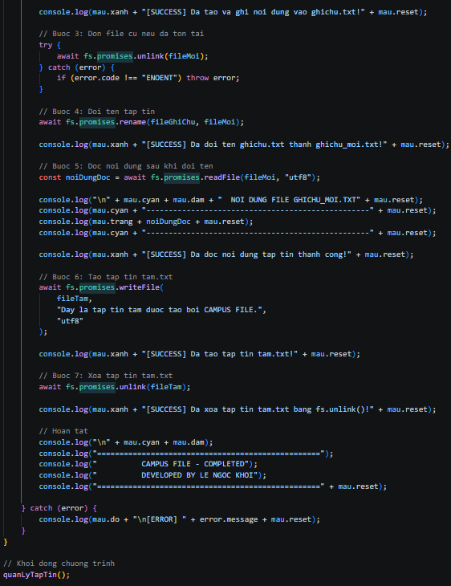
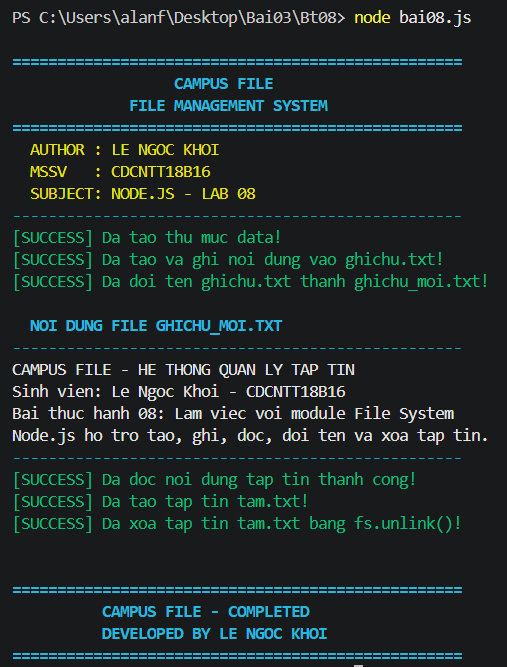

# BÀI THỰC HÀNH 08 – QUẢN LÝ TẬP TIN VỚI FILE SYSTEM

## 1. Thông tin sinh viên

- **Họ và tên:** Lê Ngọc Khôi
- **MSSV:** CDCNTT18B16
- **Ngành:** Công nghệ thông tin
- **Môn học:** Lập trình Node.js
- **Bài thực hành:** 08

## 2. Giới thiệu

CAMPUS FILE là chương trình quản lý tập tin được xây dựng bằng Node.js, sử dụng module File System (`fs`) để thực hiện các thao tác cơ bản với thư mục và tập tin.

Chương trình thực hiện tạo thư mục, ghi nội dung, đổi tên, đọc và xóa tập tin.

## 3. Công nghệ sử dụng

- Node.js
- Module `fs`
- Module `path`
- Visual Studio Code

## 4. Các chức năng chính

- Tạo thư mục `data`.
- Tạo tập tin `ghichu.txt`.
- Ghi ít nhất 3 dòng nội dung vào tập tin.
- Đổi tên thành `ghichu_moi.txt` bằng `fs.rename()`.
- Đọc và hiển thị nội dung tập tin sau khi đổi tên.
- Tạo tập tin `tam.txt`.
- Xóa tập tin `tam.txt` bằng `fs.unlink()`.
- Hiển thị thông báo kết quả từng thao tác.

## 5. Cấu trúc thư mục

```text
Bt08/
├── bai08.js
├── README.md
├── data/
│   └── ghichu_moi.txt
└── images/
```

## 6. Hướng dẫn thực hiện

### Bước 1: Kiểm tra Node.js

```bash
node -v
```

### Bước 2: Chạy chương trình

```bash
node bai08.js
```

### Bước 3: Kiểm tra kết quả

Quan sát thông báo trên Terminal để kiểm tra các thao tác tạo thư mục, ghi file, đổi tên, đọc nội dung và xóa file.

## 7. Hình ảnh minh chứng

### 7.1. Cấu trúc thư mục



### 7.2. Nội dung file ghichu_moi.txt



### 7.2. Mã nguồn chương trình





### 7.3. Kết quả chạy chương trình



## 8. Tổng kết

Qua bài thực hành, em đã tìm hiểu và vận dụng module File System trong Node.js để quản lý thư mục và tập tin.

Chương trình đã thực hiện thành công các thao tác tạo thư mục, ghi dữ liệu, đổi tên tập tin, đọc nội dung và xóa tập tin theo yêu cầu đề bài.

**Người thực hiện: Lê Ngọc Khôi**

**MSSV: CDCNTT18B16**