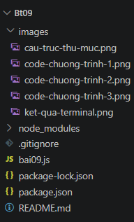
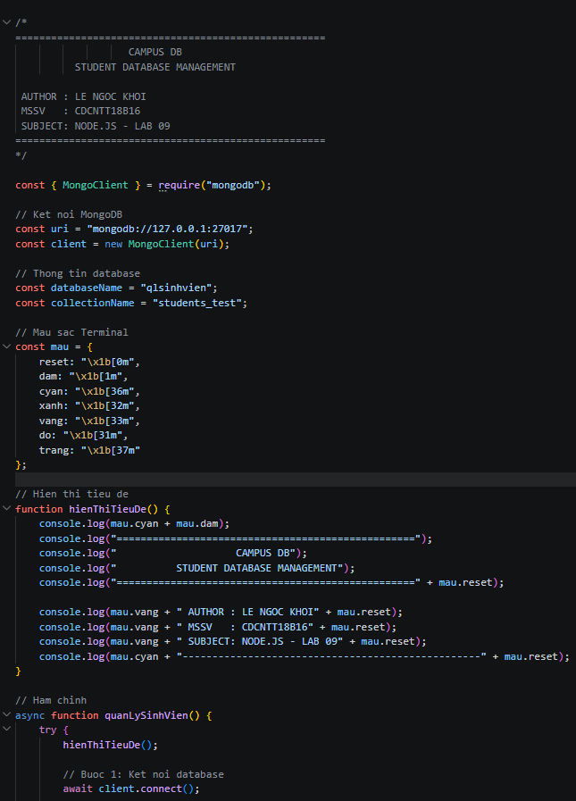
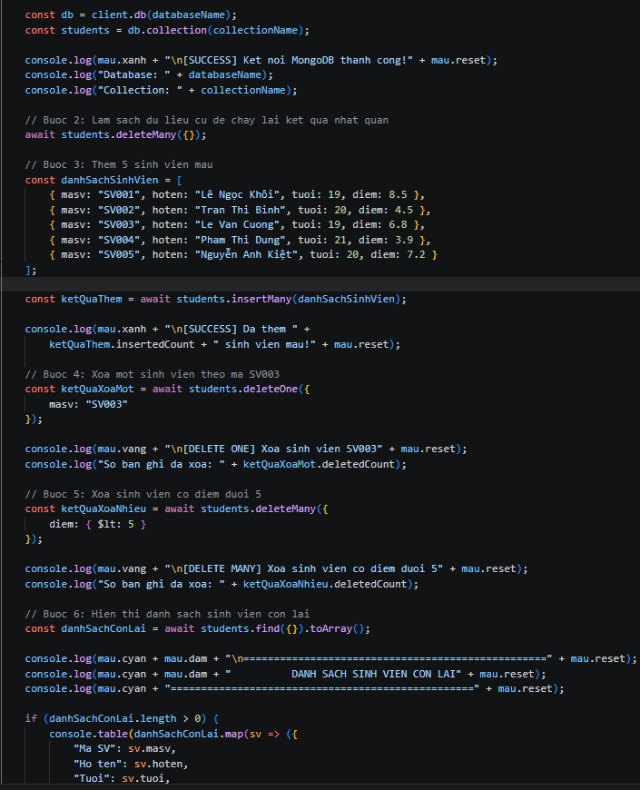
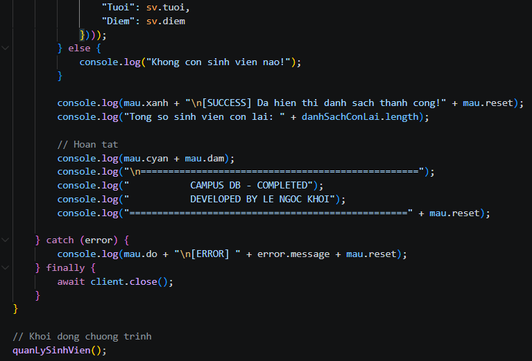
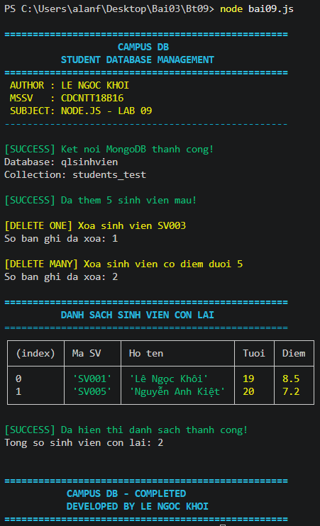

# CAMPUS DB – STUDENT DATABASE MANAGEMENT

## BÀI THỰC HÀNH 09: XÓA DỮ LIỆU CÓ ĐIỀU KIỆN TRONG MONGODB

### 1. Thông tin sinh viên

- **Họ và tên:** Lê Ngọc Khôi
- **MSSV:** CDCNTT18B16
- **Ngành:** Công nghệ thông tin
- **Môn học:** Node.js
- **Bài thực hành:** Bài 09

### 2. Giới thiệu

CAMPUS DB là chương trình quản lý dữ liệu sinh viên sử dụng Node.js và MongoDB.

Chương trình thực hiện thêm dữ liệu sinh viên, xóa một sinh viên theo mã sinh viên, xóa nhiều sinh viên có điểm dưới 5 và hiển thị danh sách sinh viên còn lại.

### 3. Công nghệ sử dụng

- Node.js
- MongoDB
- MongoDB Node.js Driver
- Visual Studio Code

### 4. Cấu hình cơ sở dữ liệu

- **Database:** `qlsinhvien`
- **Collection:** `students_test`
- **Số sinh viên mẫu:** 5

### 5. Các chức năng chính

1. Kết nối MongoDB bằng `MongoClient`.
2. Thêm 5 sinh viên mẫu bằng `insertMany()`.
3. Xóa một sinh viên có mã `SV003` bằng `deleteOne()`.
4. Xóa các sinh viên có điểm dưới 5 bằng `deleteMany()`.
5. Hiển thị số lượng bản ghi đã xóa.
6. Sử dụng `find()` để hiển thị danh sách sinh viên còn lại.

### 6. Các lệnh thực hiện

**Bước 1: Khởi tạo dự án**

```bash
npm init -y
```

**Bước 2: Cài đặt thư viện MongoDB**

```bash
npm install mongodb
```

**Bước 3: Chạy chương trình**

```bash
node bai09.js
```

### 7. Hình ảnh minh chứng

#### 7.1. Cấu trúc thư mục



#### 7.2. Mã nguồn chương trình







#### 7.3. Kết quả chạy chương trình



### 8. Kết quả thực hiện

Sau khi chạy chương trình, thu được kết quả:

- Thêm thành công 5 sinh viên.
- Xóa thành công 1 sinh viên bằng `deleteOne()`.
- Xóa thành công 2 sinh viên bằng `deleteMany()`.
- Còn lại 2 sinh viên trong collection.

| Mã SV | Họ tên | Tuổi | Điểm |
|---|---|---:|---:|
| SV001 | Lê Ngọc Khôi | 19 | 8.5 |
| SV005 | Hoàng Văn Em | 20 | 7.2 |

### 9. Kết luận

Qua bài thực hành 09, em đã hiểu cách kết nối Node.js với MongoDB, thêm dữ liệu và sử dụng các phương thức `deleteOne()`, `deleteMany()` để xóa dữ liệu có điều kiện. Đồng thời, em biết cách sử dụng `find()` để truy vấn và hiển thị các bản ghi còn lại.

---

**CAMPUS DB – DEVELOPED BY LE NGOC KHOI**

**MSSV: CDCNTT18B16**