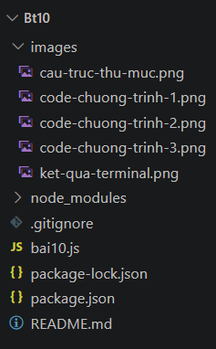
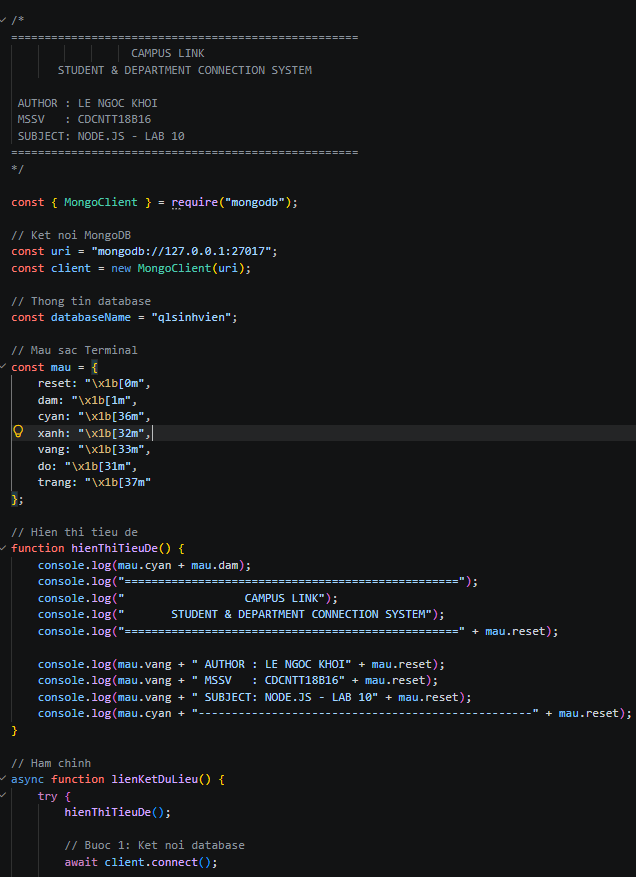
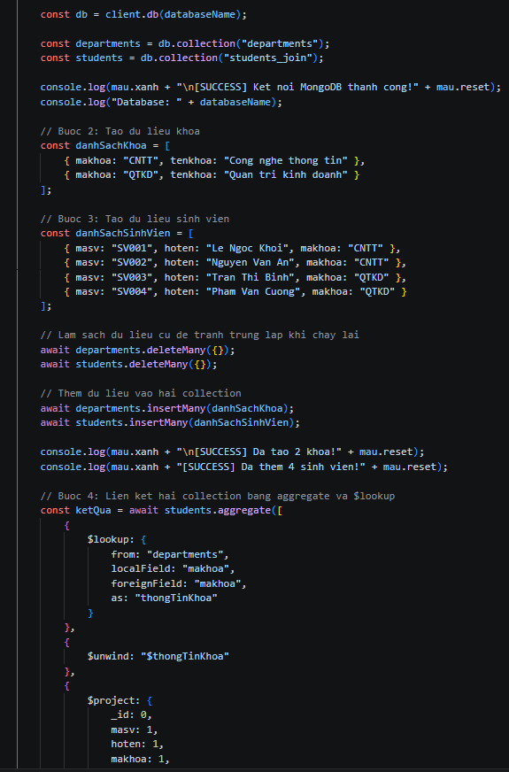
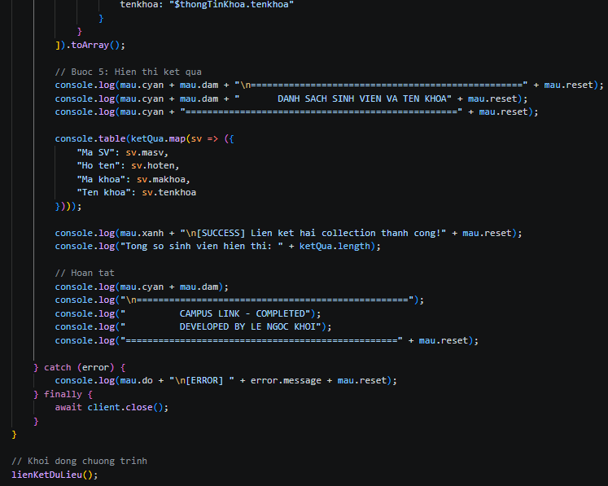
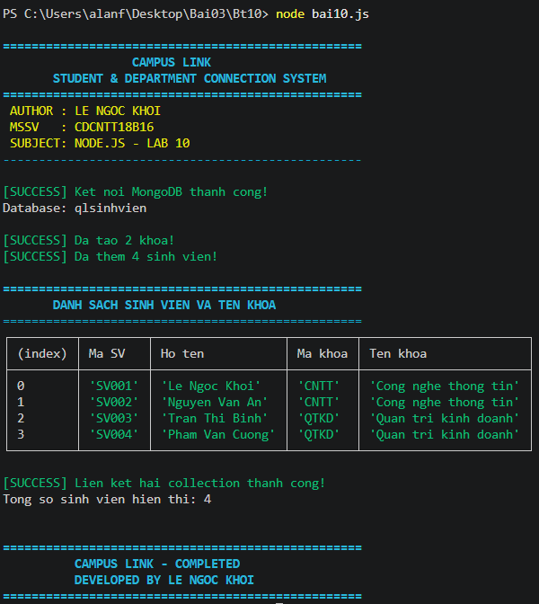

# CAMPUS LINK – STUDENT & DEPARTMENT CONNECTION SYSTEM

## BÀI THỰC HÀNH 10: LIÊN KẾT HAI COLLECTION TRONG MONGODB

### 1. Thông tin sinh viên

- **Họ và tên:** Lê Ngọc Khôi
- **MSSV:** CDCNTT18B16
- **Ngành:** Công nghệ thông tin
- **Môn học:** Node.js
- **Bài thực hành:** Bài 10

### 2. Giới thiệu

CAMPUS LINK là chương trình thực hành liên kết dữ liệu giữa hai Collection trong MongoDB bằng Node.js.

Chương trình sử dụng phương thức `aggregate()` kết hợp với toán tử `$lookup` để liên kết thông tin sinh viên với thông tin khoa thông qua mã khoa (`makhoa`).

### 3. Công nghệ sử dụng

- Node.js
- MongoDB
- MongoDB Node.js Driver
- Visual Studio Code

### 4. Cấu hình cơ sở dữ liệu

- **Database:** `qlsinhvien`
- **Collection 1:** `departments`
- **Collection 2:** `students_join`

### 5. Dữ liệu thực hành

**Collection departments:**

| Mã khoa | Tên khoa |
|---|---|
| CNTT | Công nghệ thông tin |
| QTKD | Quản trị kinh doanh |

**Collection students_join:**

| Mã SV | Họ tên | Mã khoa |
|---|---|---|
| SV001 | Le Ngoc Khoi | CNTT |
| SV002 | Nguyen Van An | CNTT |
| SV003 | Tran Thi Binh | QTKD |
| SV004 | Pham Van Cuong | QTKD |

### 6. Các chức năng chính

1. Kết nối cơ sở dữ liệu MongoDB.
2. Tạo Collection `departments` và thêm dữ liệu khoa.
3. Tạo Collection `students_join` và thêm dữ liệu sinh viên.
4. Sử dụng `aggregate()` kết hợp `$lookup` để liên kết hai Collection.
5. Sử dụng `$unwind` và `$project` để hiển thị thông tin khoa.
6. Hiển thị danh sách sinh viên kèm tên khoa tương ứng.

### 7. Các lệnh thực hiện

**Bước 1: Khởi tạo dự án**

```bash
npm init -y
```

**Bước 2: Cài đặt thư viện MongoDB**

```bash
npm install mongodb
```

**Bước 3: Chạy chương trình**

```bash
node bai10.js
```

### 8. Hình ảnh minh chứng

#### 8.1. Cấu trúc thư mục



#### 8.2. Mã nguồn chương trình







#### 8.3. Kết quả chạy chương trình



### 9. Kết quả thực hiện

Sau khi chạy chương trình, thu được kết quả:

- Tạo thành công 2 khoa.
- Thêm thành công 4 sinh viên.
- Liên kết thành công hai Collection bằng `$lookup`.
- Hiển thị đầy đủ mã sinh viên, họ tên, mã khoa và tên khoa tương ứng.

### 10. Kết luận

Qua bài thực hành 10, em đã hiểu cách liên kết dữ liệu giữa hai Collection trong MongoDB bằng phương thức `aggregate()` và toán tử `$lookup`.

Đồng thời, em biết cách sử dụng `$unwind` và `$project` để xử lý và hiển thị dữ liệu sau khi liên kết.

---

**CAMPUS LINK – DEVELOPED BY LE NGOC KHOI**

**MSSV: CDCNTT18B16**